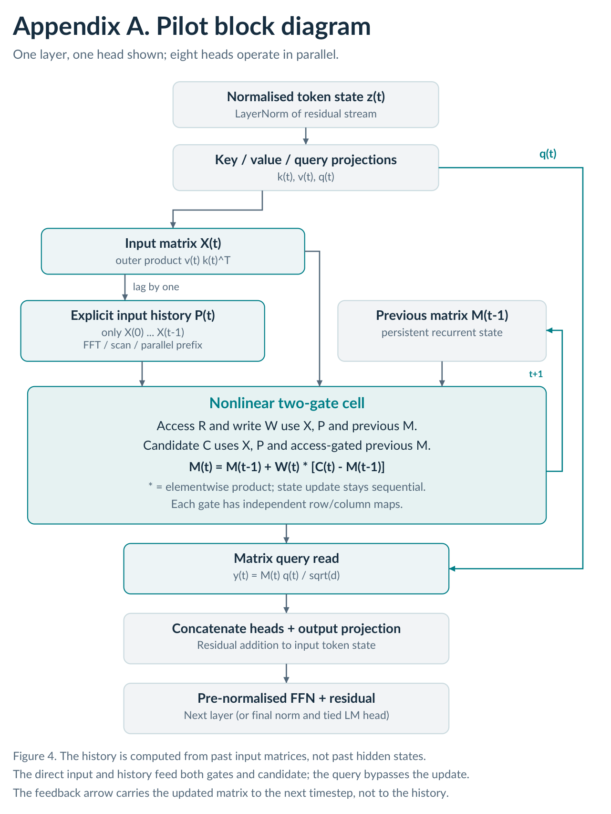

# Pilot

**Nonlinear matrix memory with FFT-compatible exponential history**

Pilot (named after the pilot whale) is an experimental recurrent language model descended from ILRM and Matrix EXILRM. It combines an explicit, strictly causal exponential history of inputs with an independently evolving, nonlinear matrix memory. The aim is to study a different way of processing sequences, not to claim that long-term memory is solved.

[Research report (PDF)](Pilot_Research_Report.pdf) · [Kaggle experiment notebook](Pilot_Kaggle.ipynb) · [Recorded results](results.json) · [Licence](LICENSE)

## Architecture



In each layer, the normalised token representation produces key, value and query vectors. The input matrix is an outer product. A separate history is formed from previous input matrices (not the hidden state), and the access and write gates use both the input and history along with the preceding matrix state.

```text
X_t = v_t k_t^T
P_0 = 0
P_t = sum_{j=1..t} lambda^(j-1) X_{t-j} / sum_{j=1..t} lambda^(j-1)
R_t = sigmoid(L_rX(X_t) + L_rP(P_t) + L_rM(M_{t-1}))
W_t = sigmoid(L_wX(X_t) + L_wP(P_t) + L_wM(M_{t-1}))
C_t = tanh(L_cX(X_t) + L_cP(P_t) + L_cM(R_t * M_{t-1}))
M_t = M_{t-1} + W_t * (C_t - M_{t-1})
y_t = M_t q_t / sqrt(d)
```

Here `*` denotes elementwise multiplication. Each map uses row/column mixing, `L(A) = U A + A V^T`, with a bias on the current-input path. Maps are independent across gates, paths and layers, shared across heads within a layer. The state starts at zero, head reads are concatenated and projected, and a pre-normalised residual FFN completes the block. The tested model uses fixed `lambda = 0.9`, eight 8×8 matrix heads per layer, three layers, width 64, and tied input/output embeddings.

### Pilot FFT, Pilot Scan and Pilot Parallel Scan

These are **three numerical backends of the same architecture**, not three different learned architectures. FFT evaluates a zero-padded causal convolution with kernel `[0, 1, lambda, lambda², ...]`, without materialising a temporal Toeplitz matrix. The scan uses `S_{t+1} = X_t + lambda S_t`, `D_{t+1} = 1 + lambda D_t`, and `P_t = S_t / D_t` (zero initial state, `P_0 = 0`). Parallel prefix evaluates the affine history composition in logarithmic stages. Only this input-history path is parallelised; the nonlinear, state-dependent cell remains sequential. The learned memory matrix need not be Toeplitz, diagonal or circulant. FFT convolution without explicit Toeplitz storage is established mathematics; the architectural contribution under study is the combination of explicit history and nonlinear gated matrix correction.

## Recorded experiment: 63.57M scored targets per model

Two Tesla T4 GPUs, one model per GPU; one seed (20261109). Same FineWeb-Edu sample-10BT local Parquet source, shared 4,096-piece training-only BPE tokenizer, document-hash-separated splits, 256-token training context, 16 sequences per update, FP32 and AdamW. Both completed 15,520 updates and 63,569,920 scored next-token targets. No memory-task training or special key/value input hints. The Transformer uses learned positional embeddings and four attention heads; it is not a RoPE baseline.

| Metric | Transformer | Pilot FFT |
|---|---:|---:|
| Parameters | 428,608 | 428,523 |
| Validation NLL | 4.8388 | 4.6438 |
| Test NLL | 4.8382 | 4.6554 |
| Test perplexity | 126.24 | **105.15** |
| Test top-1 | 17.61% | **20.35%** |
| Training targets/sec | **405,610** | 6,776 |
| Multiple-choice memory probes | 17/96 | 11/96 |
| Unrestricted correct next-token probes | 0/96 | 0/96 |

Pilot obtains 16.7% lower test perplexity at closely matched parameters and equal tokens. This is positive evidence for language modelling, **not a general superiority claim**. Validation and test scores each cover only 8,192 scored positions, and there is no independent seed replication. Training was roughly 60× slower in this implementation. Neither model reliably solves the zero-shot recall, binding, overwrite or multi-hop tasks, and Pilot's repeated-passage benefit becomes negligible at longer gaps. A model can process a long sequence without retaining useful distant information. The Transformer is limited to its learned 256-token context; long-input comparisons crop it to that suffix.

| Pilot backend (short calibration) | Eager targets/s | CUDA graph targets/s |
|---|---:|---:|
| Sequential scan | 2,298 | 5,624 |
| Parallel prefix scan | 2,570 | 6,642 |
| FFT | 2,579 | 6,760 |

The selected FFT + graph mode completed the full run. Scan and parallel scan were tested on identical weights and through short forward/backward/optimiser comparisons; **no separate full-budget scan-trained endpoint exists**. Final-checkpoint maximum logit differences from FFT were about 1.24e-5 (scan) and 1.34e-5 (parallel). CUDA graphs replay the same equations and do not establish bitwise equivalence for arbitrarily long training trajectories.

## Reproduce the experiment

1. Import `Pilot_Kaggle.ipynb` into Kaggle, select **GPU T4 ×2**, and attach a local FineWeb-Edu sample-10BT Parquet shard. The default glob is `/kaggle/input/**/000_00000.parquet`; edit it to match the intended input. The notebook needs PyTorch, NumPy, PyArrow and SentencePiece (and pandas for the displayed summary).
2. Run all cells. The notebook writes the original Python modules `research500.py` and `exilrm_time_budget.py` into the working directory; their embedded source matches the recorded run archive. Internal variant names `standard` and `matrix_fixed` are unchanged. The runner prepares the data, verifies the history and graph execution, benchmarks candidates, then chooses an equal token budget that fits a four-hour scheduling target (100M cap per model). The budget is hardware-dependent, not a promise to reproduce 63,569,920 targets. Do not change the architecture or training context when attempting a direct replication.
3. For exact data preparation, use the recorded seed and source in `results.json` (`files/plan.json`, `files/data/manifest.json`, and source/tokenizer manifests). To skip preparation, set `EXISTING_DATA_ROOT` to a directory containing `data/manifest.json`, `data/spm.model` and `data/{train,valid,test}.bin`.
4. Inspect the resulting archive for the matched checkpoint, final held-out metrics, numerical checks and memory audit. A partial or failed worker is not a completed comparison. The notebook's deadline includes preparation, calibration and evaluation; exceptional platform interruptions can still leave incomplete results.

The release contains the notebook's exact experiment code and recorded JSON/CSV evidence, but **not** the source Parquet, large token arrays, trained checkpoints or tokenizer binaries. These were not necessary for a compact repository release. The original run archive contains the final checkpoints and tokenizer; retain it separately if you want to evaluate the exact trained weights. To extract Python source without running Kaggle, execute the two embedded source-writing cells with `WORK` set to an output directory, or read their string literals with Python's `ast.literal_eval`.

## Repository contents

| File | Purpose |
|---|---|
| `README.md` | Overview, equations, results and reproducibility instructions |
| `LICENSE` | Software and documentation terms |
| `Pilot_Kaggle.ipynb` | Self-contained original experiment code and runner |
| `Pilot_Research_Report.pdf` | Ten-page report, including the corrected architecture diagram |
| `Pilot_Block.png` | Standalone architecture figure |
| `results.json` | Recorded plan, summaries, probes, verification and CSV audit tables |

`results.json` preserves the original archive's JSON objects and CSV text keyed by relative path under `files`. For example, `files["summary.json"]` is the recorded summary; `files["matrix_fixed/evaluation.json"]` is Pilot's final evaluation. No new training is represented by these release files.

## Next steps

Replicate across seeds, larger models and broader held-out text; compare against stronger positional baselines and equal wall-clock budgets; isolate multi-timescale decay initialisation; run larger repeated-passage and counterfactual tests; and optimise the sequential recurrent kernel while checking gradients. Long-term memory and practical efficiency remain open problems.

## Attribution and licence

Rickey1990, 2026. Pilot is descended from the original ILRM research. Software: PolyForm Noncommercial 1.0.0. Original report and figure: CC BY-NC 4.0. See [LICENSE](LICENSE). These are noncommercial/source-available terms, not an unrestricted open-source licence. FineWeb-Edu and third-party dependencies have separate terms. Dataset: [HuggingFaceFW/fineweb-edu](https://huggingface.co/datasets/HuggingFaceFW/fineweb-edu). The report is an analysis of the supplied run archive, not an independent replication or an exhaustive novelty review.
